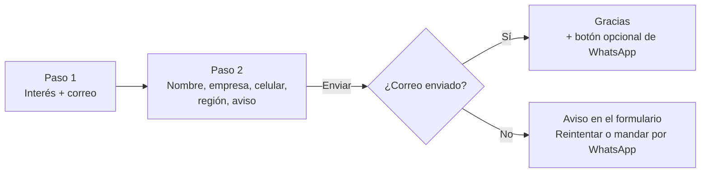

# Guía técnica del sitio Cadgrafics

Esta guía es para quien va a **editar el diseño o el programa del formulario**. Explica cómo está armado el sitio por dentro.

Si solo necesitas saber qué página existe, cómo llega un contacto o qué carpeta se publica, lee primero el **[README principal](../README.md)**. Está escrito para cualquier persona del equipo.

**Contenido**

1. [Cómo funciona una página](#1-cómo-funciona-una-página)
2. [Mapa de páginas](#2-mapa-de-páginas)
3. [Identidad visual y sistema de diseño](#3-identidad-visual-y-sistema-de-diseño)
4. [Componentes disponibles](#4-componentes-disponibles)
5. [Comportamiento (JavaScript)](#5-comportamiento-javascript)
6. [Formularios de contacto](#6-formularios-de-contacto)
7. [WhatsApp](#7-whatsapp)
8. [Videos e imágenes](#8-videos-e-imágenes)
9. [Animaciones y accesibilidad](#9-animaciones-y-accesibilidad)
10. [SEO y seguridad](#10-seo-y-seguridad)
11. [Crear o editar una página](#crear-o-editar-una-página)
12. [Publicar](#12-publicar)
13. [Solución de problemas](#13-solución-de-problemas)

---

## 1. Cómo funciona una página

Cada página es un archivo `.html` completo e independiente. Todas cargan los mismos archivos compartidos, **en este orden**:

```
<head>
  Content-Security-Policy        (qué recursos externos se permiten)
  Google Fonts · Inter           (tipografía)
  assets/css/shared/header.css   (menú superior heredado; NO modificar)
  assets/css/site.css            (todo el diseño del sitio)
</head>
<body data-page="Nombre de la página">
  header  → menú
  main    → hero + secciones + contacto (#contacto) + banda final (.cta-band)
  footer  → oficinas, enlaces, redes, aviso de privacidad
  botón flotante de WhatsApp + barra inferior en celular
  assets/js/shared/site-common.js  (menú)
  assets/js/site.js                (formularios, WhatsApp, animaciones, videos)
</body>
```

- `site.css` se carga **después** de `header.css` y ajusta sus colores sin tocar el archivo original.
- `data-page` en `<body>` es el nombre de la página: aparece en los correos y mensajes de WhatsApp para saber de dónde llegó cada contacto.
- No hay compilación ni dependencias: lo que editas es lo que se publica.

---

## 2. Mapa de páginas

| Página | Archivo | `data-page` |
|---|---|---|
| Inicio | `index.html` | Inicio |
| Autodesk | `pages/autodesk/home-autodesk.html` | Autodesk |
| AEC Collection | `pages/autodesk/aec-collection.html` | Autodesk AEC Collection |
| Product Design & Manufacturing | `pages/autodesk/pdm-collection.html` | Autodesk Product Design & Manufacturing |
| Media & Entertainment | `pages/autodesk/me-collection.html` | Autodesk Media & Entertainment |
| Programa de Adopción | `pages/adopcion_autodesk/adopcion_Autodesk.html` | Programa de Adopción Autodesk |
| Adobe | `pages/adobe/home-adobe.html` | Adobe |
| Creative Cloud | `pages/adobe/creative-cloud.html` | Adobe Creative Cloud |
| Acrobat Studio | `pages/adobe/acrobat-studio.html` | Adobe Acrobat Studio |
| Microsoft 365 | `pages/microsoft/home-microsoft.html` | Microsoft 365 |
| Chaos | `pages/chaos/home-chaos.html` | Chaos |
| SketchUp | `pages/sketchup/home-sketchup.html` | SketchUp |
| Dell | `pages/dell/home-dell.html` | Dell |
| HP gran formato | `pages/hp/home-hp.html` | HP gran formato |
| Mac | `pages/mac/home-mac.html` | Mac para empresas |
| Aviso de privacidad | `pages/legal/aviso-privacidad.html` | Aviso de privacidad |

---

## 3. Identidad visual y sistema de diseño

### Colores y tipografía

| Elemento | Valor | Variable en `site.css` |
|---|---|---|
| Rojo Cadgrafics | Pantone Process 1807 C · CMYK 0/100/96/28 → `#B80007` | `--red` |
| Rojo profundo (fin del degradado) | CMYK 0/100/100/60 → `#660000` | `--red-deep`, `--red-gradient` |
| Negro | Pantone Process Black → `#000000` | `--ink` |
| Papel (fondo claro cálido) | `#F7F6F3` | `--paper` |
| Verde WhatsApp | `#075E54` (texto blanco encima, contraste 7.7:1) | `--wa`, `--success` |
| Tipografía | **Inter** (400–900), tamaños tomados de la página de inicio original | `--font-main`, `--fs-*` |

Reglas:

- Sobre fondo negro, el rojo solo va en **títulos grandes** (en texto pequeño no tiene contraste suficiente). Las etiquetas pequeñas van en blanco con una línea o punto rojo.
- **Nunca** pongas estilos dentro de las páginas (`style="…"`). Usa las clases de `site.css`; si falta algo, agrégalo ahí.
- Los espacios (márgenes laterales, aire entre secciones, separación entre tarjetas) también son variables: `--gutter`, `--section-y`, `--stack`, `--grid-gap`. Cambiarlas ajusta todo el sitio de forma pareja.

### Orden de módulos en cada página

Todas las páginas siguen el sistema de la marca **Identidad → Impacto → Información → Conversión**:

| Módulo | Color | Qué comunica | En el código |
|---|---|---|---|
| Identidad | Rojo 1807 C | Quién habla | Logotipo del fabricante a la derecha (`img.hero__logo`) o, si la página no tiene logotipo, etiqueta del hero: `.eyebrow` o `.hero__badge`. Las páginas de Autodesk conservan el logotipo arriba a la izquierda con la etiqueta roja debajo. |
| Impacto | Negro | Qué queremos que recuerden | `.hero` y, si hace falta, una banda `.trust` o `.section--ink` justo después |
| Información | Blanco y papel alternados | Qué necesitan entender | `.section` y `.section.section--paper` alternadas |
| Conversión | Rojo profundo | Qué queremos que hagan | Banda final `.cta-band` |

No uses `.section--ink` (negro) a mitad de página. Excepciones: el bloque "¿Buscas otra colección?" de PD&M y M&E, porque el logo de Autodesk de ese bloque solo existe en blanco, y "Quiénes Somos" del inicio, que va justo después del hero y de la banda de partners (sigue siendo la zona de impacto).

### Variantes del hero

| Clase | Efecto |
|---|---|
| `.hero` | Hero oscuro con imagen o video de fondo; en escritorio ocupa la primera pantalla completa (mínimo 640 px), así la siguiente sección no se asoma cortada. |
| `.hero--plain` | Sin imagen: fondo negro con un brillo rojo. |
| `.hero--compact` | Más bajo (lo usa el aviso de privacidad). |
| `.hero--low` | El contenido se apoya más abajo (Programa de Adopción). |
| `.hero__grid--single` | Una sola columna de texto (sin formulario ni video al lado). |
| `.hero__grid--brand` | Texto a la izquierda y logotipo del fabricante arriba a la derecha, alineado con el título, en un panel translúcido. El `img.hero__logo` va después del bloque de texto, como hijo directo del grid; en móvil sube arriba del título. |
| `.hero__grid--brand-sm` | Se suma a `.hero__grid--brand`: panel del logotipo compacto (72 px de alto). Lo usan Chaos, HP, Mac, Microsoft y SketchUp; Dell conserva el panel grande. |
| `.hero__grid--brand-top` | Se suma a `.hero__grid--brand`: el logotipo sube a la esquina superior derecha del hero, cerca del menú, mientras el texto sigue centrado. Lo usan Chaos y Microsoft. |
| `.hero__grid--brand-xs` | Se suma a `.hero__grid--brand-sm`: panel del logotipo aún más chico (56 px). Solo para logotipos que se siguen leyendo a ese tamaño; lo usa Microsoft. |
| `.hero__grid--media-logo` | Texto a la izquierda; a la derecha, el logotipo encima del video (`.hero__media`). El `img.hero__logo` va al final del grid. |
| `.hero__grid--media-wide` | Se suma a `.hero__grid--media-logo`: video más grande y logotipo más discreto encima (inicio de Adobe). |

---

## 4. Componentes disponibles

**Catálogo visual con ejemplos de código:** abre `docs/componentes.html` con Live Server.

| Componente | Clases principales | Para qué |
|---|---|---|
| Secciones | `.section`, `.section--paper`, `.section--ink`, `.section--tight`, `.section-header` | Estructura y fondo de cada bloque |
| Botones | `.btn` + `.btn--primary` / `--ghost` / `--outline` / `--wa`, `.btn--xl`, `.btn--block` | Acciones (`--ghost` solo sobre fondo oscuro) |
| Tarjetas | `.grid--2/3/4`, `.card`, `.card--featured`, `.card--dark`, `.card__tag`, `.card__actions` | Productos, retos, soluciones |
| Ventajas | `.feature`, `.feature__icon`, `.app`, `.checklist` | Listas de beneficios |
| Imagen + texto | `.split`, `.split--reverse`, `.split__media`, `.split__body` | Bloques mitad y mitad |
| Proceso | `.steps`, `.step-card` | Antes · Durante · Después. Para poner el número junto a la etapa, envuélvelos en `.step-card__head`; el `h3` que sigue queda centrado. |
| Cifras | `.stats` > `.stat` | Números grandes con línea roja (animados) |
| Casos de éxito | `.case-feature`, `.case`, `.case__media`, `.case__body` | Testimonios con video de YouTube |
| Casos del inicio | `.case-cards` > `.case-card`, `.case-card__media`, `.case-card__play`, `.case-card__company` | Tres tarjetas iguales en rojo profundo con botón de reproducir al centro; una columna (máx. 560 px) por debajo de 1025 px |
| Problemas del inicio | `.problems` > `.problem-card`, `.problem-card__icon` | Cinco tarjetas con borde rojo y brillo suave |
| Personas | `.people` > `.person` + `.person__avatar` | Tarjetas de contacto (foto o iniciales) |
| Planes | `.plan`, `.plan--featured`, `.plan__badge` | Comparar opciones |
| Tablas | `.table-wrap` > `.spec-table` | Especificaciones |
| Pestañas | `[data-tabs]`, `.tabs__list`, `.tabs__tab` | Contenido por categoría |
| Preguntas frecuentes | `.faq` (con `<details>`) | Dudas comunes |
| Galería | `.gallery` | Fotos de producto |
| Credenciales | `.trust`, `.logo-wall`, `.badge-row` | Logos de partners e insignias |
| Nota | `.note` | Aviso destacado |
| Banda final | `.cta-band`, `.stage-grid` | Llamado a la acción |
| Animación de entrada | `.reveal` | El elemento aparece al bajar |
| Texto justificado | Automático desde 768 px en `.hero-description`, `.prose`, subtítulos de `.split__body`, párrafos de `.step-card`, testimonios, `.faq`, `.note`, etapas de la banda final y `.legal` | Las tarjetas, planes y productos y todo en celular se quedan a la izquierda: son textos cortos en columnas angostas y justificados abren huecos entre palabras. |
| Carrusel | `.carousel[data-carousel]` > `ul.carousel__track` + `.carousel__nav` | Tarjetas que se deslizan de lado (novedades de Chaos) |

---

## 5. Comportamiento (JavaScript)

Todo vive en `assets/js/site.js`, organizado en 10 bloques numerados. Se activa con **atributos en el HTML**, así que normalmente no hace falta tocar el JavaScript.

| # | Función | Cómo se activa en el HTML |
|---|---|---|
| 1 | Menú (abrir/cerrar, submenús) | Automático (usa `site-common.js`) |
| 2 | Formulario por pasos | `<form data-lead-form="…" data-endpoint="">` → ver [sección 6](#6-formularios-de-contacto) |
| 3 | Prellenar el formulario desde un botón | El enlace debe terminar en `#contacto`. Ahí, `data-interest` debe ser el valor exacto de una opción y `data-stage` uno de `evaluar`, `cotizar` o `descubrir`. Un enlace a otra sección no cambia la etapa. |
| 4 | Pestañas accesibles (teclado con flechas) | `data-tabs` en el contenedor, botones `role="tab"` con `aria-controls` |
| 5 | WhatsApp por región | Enlaces con `data-wa` → ver [sección 7](#7-whatsapp) |
| 6 | Aparición al bajar | Clase `reveal` |
| 7 | Cifras que cuentan | Automático en cualquier `.stats` |
| 8 | Videos ambientales | `<video data-ambient muted loop>` (en bucle, sin botón) |
| 9 | Carril infinito de insignias | `data-marquee` en una `.badge-row` con 3 o más imágenes |
| 10 | Carrusel de tarjetas | `data-carousel` en un `.carousel` con un `ul.carousel__track` (con `id`) y un `.carousel__nav hidden` con los botones `data-carousel-prev` / `data-carousel-next` y un `.carousel__dots` vacío. El script muestra la navegación y crea un punto por posición. Sin JavaScript el carril se desliza igual. |

Valores importantes al inicio de `site.js`:

```js
const CONTACT_ENDPOINT = '/contacto.php';                                         // script que envía el correo
const WHATSAPP = { 'CDMX y centro': '525531120508', Occidente: '523314040396' }; // Norte y Sur usan el de CDMX
const WA_LABEL = { '525531120508': '55 3112 0508', '523314040396': '33 1404 0396' };
const STAGE_LABEL = {
  descubrir: 'Explorando, quiere una recomendación',
  evaluar: 'Quiere una demo',
  cotizar: 'Quiere una cotización'
};
```

El destinatario del correo está en `contacto.php` (`RECIPIENT`), no en el JavaScript.

---

## 6. Formularios de contacto

Cada página (excepto el aviso de privacidad) tiene **un formulario** dentro de `#contacto` (en el inicio está en el hero).

### Recorrido del visitante



1. **Paso 1:** elige en qué le podemos ayudar (`name="interes"`) y escribe su correo.
2. **Paso 2:** nombre, empresa, celular, industria si la página la pide, región y aceptación del aviso de privacidad.
3. **Enviar:** el botón cambia a «Enviando…». `contacto.php` valida y manda un correo a marketing@cadgrafics.com.mx.
4. **Éxito:** se muestra «Recibimos tu solicitud» con un botón opcional para seguir por WhatsApp.
5. **Error** (sin internet, origen no permitido, demasiados intentos o el servidor no pudo enviar el correo): aparece un aviso. La persona puede reintentar o mandar los mismos datos por WhatsApp a la oficina de su región.

El paso 3 (usuarios, plazo, mensaje) está en el HTML para un CRM futuro. Con `data-endpoint=""` no se muestra: el contador dice «Paso 1 de 2».

### El correo que llega

- **Para:** marketing@cadgrafics.com.mx (fijo; el visitante no elige destinatario).
- **Asunto:** `Nuevo contacto web · {página} · {interés}` — ej. *Nuevo contacto web · Inicio · Licencias de software*.
- **Contenido:** interés, correo, nombre, empresa, celular, industria si venía, región, etapa, página, dirección de la página (solo si es `https://cadgrafics.com.mx` o `www`), campaña (`utm_source`, `utm_medium`, `utm_campaign`) y la frase de aceptación del aviso.
- **Responder** contesta directo al correo del cliente.
- **Etapa:** solo si la persona pulsó un enlace que termina en `#contacto`.

| `data-stage` | Texto en el correo |
|---|---|
| `descubrir` | Explorando, quiere una recomendación |
| `evaluar` | Quiere una demo |
| `cotizar` | Quiere una cotización |

Si nadie pulsó uno de esos enlaces, el campo oculto trae `evaluar` y el correo dice «Quiere una demo».

### Cómo se envía

`assets/js/site.js` hace `POST` JSON a `/contacto.php`. El script:

- solo acepta el método POST y el origen `https://cadgrafics.com.mx` o `https://www.cadgrafics.com.mx`;
- admite como máximo 5 envíos por hora y por dirección IP; si no puede contar, rechaza;
- exige correo válido, celular de 10 dígitos, nombre, empresa, interés, una región de la lista y un consentimiento que empiece por «Sí»;
- ignora cualquier etiqueta que no esté en `ALLOWED_FIELDS`;
- quita saltos de línea, codifica el asunto en UTF-8 y pone `Reply-To` solo con el correo ya validado;
- si `mail()` falla, escribe el mismo texto en `private/leads/failed.log` (Apache niega esa carpeta) y responde error para que el visitante use WhatsApp.

**Cambiar el destinatario:** edita `RECIPIENT` en `contacto.php`.

**Agregar un campo:** el nombre del input debe estar en `SHORT_LABEL` de `site.js` (o la etiqueta visible se convierte en la clave) y esa clave en español debe estar en `ALLOWED_FIELDS`. Si el servidor debe rechazar el envío cuando falte, agrégalo también a la validación de `contacto.php`.

### Validación y protección

- Cada campo obligatorio lleva `required` y un mensaje propio en `data-error` (ej. «Revisa que tenga 10 dígitos.»).
- `data-rule="fullname"` exige nombre y apellido.
- Los errores se anuncian a lectores de pantalla y el cursor salta al primer campo con error.
- El campo `_honey` («No llenar») es una trampa para robots. Si un programa lo manda lleno, el servidor responde éxito y no envía correo. Si el navegador de una persona lo rellena, el formulario muestra el aviso de reintento y no envía: así no se queda el botón mudo. No uses el nombre `website`: algunos navegadores lo rellenan solos.
- La Content-Security-Policy solo permite conexiones al propio sitio. El correo del visitante no se publica en el JavaScript.

### Conectar un CRM (opcional, a futuro)

Si algún día se usa Salesforce, HubSpot u otro CRM:

1. Pon la URL del servicio en `data-endpoint` del `<form>`.
2. El formulario cambia solo a **3 pasos**: el tercero (opcional) pide datos para calificar el contacto (usuarios, plazo, vencimiento de licencias, volumen, etc.).
3. Los campos ya llevan los nombres de Salesforce en `data-sf` (`Email`, `Company`, `MobilePhone`, `Industry`, `State`, `Tipo_Necesidad__c`, etc.).
4. Agrega el dominio del CRM a `connect-src` en la Content-Security-Policy.

---

## 7. WhatsApp

| Elemento | Comportamiento |
|---|---|
| Botón flotante (todas las páginas) | Abre chat con CDMX **55 3112 0508**. Si la persona elige «Jalisco y occidente», cambia a Guadalajara **33 1404 0396**. Norte y Sur y sureste se quedan en CDMX. |
| Botón "Continuar por WhatsApp" (después de enviar) | Mismo número según la región, con un mensaje que incluye nombre, empresa e interés. |
| Respaldo si el correo falla | Mensaje con **todos** los datos del formulario. |
| Botones fijos en la página | Enlaces `https://wa.me/52…` escritos directamente en el HTML. |

Para cambiar un número: actualiza `WHATSAPP` y `WA_LABEL` en `site.js` **y** busca el número viejo (`525531120508` o `523314040396`) en todos los `.html` con Ctrl + Shift + F.

---

## 8. Videos e imágenes

### Videos (`assets/video/`)

Todos están optimizados (H.264, sin audio, inicio rápido). Los originales se guardan fuera del sitio en `tools/_video-originals/`.

| Video | Página | Uso | Tamaño | Peso |
|---|---|---|---|---|
| `fondo-hero.mp4` | Inicio | Fondo del hero, bajo velo oscuro | — | 1.1 MB |
| `autodesk/home/video-home-autodesk.mp4` | Autodesk | Fondo del hero, bajo velo oscuro | 960 px | 5.7 MB |
| `adobe/home/video-home-adobe.mp4` | Adobe | Marco del hero | 960 px | 5.6 MB |
| `adobe/creative-cloud/creative-cloud.mp4` | Creative Cloud | Marco del hero | 960 px | 3.2 MB |
| `adobe/creative-cloud/video-landing-cc-adobe-express.mp4` | Creative Cloud | Demo en bucle | 1280 px | 2.7 MB |
| `adobe/acrobat-studio/video-agenda-demo.mp4` | Acrobat Studio | Demo en bucle | 1280 px | 2.6 MB |
| `adobe/acrobat-studio/video-acrobat-studio.mp4` | Acrobat Studio | Marco del hero | 1080 px | 1.6 MB |

- `data-ambient` (con `muted loop playsinline`): video sin sonido que se repite sin fin, en computadora y en celular, mientras está en pantalla; se detiene al salir para no gastar batería. No lleva botón de pausa.
- No se reproducen si la persona activó «reducir movimiento», «ahorro de datos» o la red es 2G (`slow-2g` o `2g`): en ese caso se ve la imagen fija (`poster`). El aviso de red lenta solo existe en algunos navegadores.
- Para comprimirlos antes de publicar: [tools/README.md](../tools/README.md).

### Imágenes (`assets/images/`)

**Regla:** lo que se comparte entre varias páginas va en una carpeta por tipo (`brand/`, `partners/`, `casos/`, `team/`); lo que pertenece a una sola página va en `{marca}/{página}/`, igual que en `pages/`. Las imágenes fijas de los videos (`poster-…`) van junto a las demás imágenes de su página.

| Carpeta | Contenido |
|---|---|
| `brand/` | Identidad Cadgrafics: `logo_cadgrafics.png`, `favicon.png`, `og-image.jpg` (vista previa al compartir en redes) |
| `partners/` | Logos de fabricantes y software: Autodesk, Adobe, Microsoft, Chaos, SketchUp, Dell, HP, Mac, CivilCAD, Lumion, Opus |
| `casos/` | Fotos de casos de éxito: `grupo-idinsa.jpg`, `grupo-alba.jpg`, `universidad-etac.jpg` |
| `team/` | Fotos del equipo (cuadradas, 192 × 192 px, JPG). Ej.: `sandra-alvarez.jpg` (6 KB) |
| `autodesk/home/`, `aec-collection/`, `pdm-collection/`, `me-collection/` | Imágenes de cada página de Autodesk |
| `autodesk/certificaciones/` | Insignias oficiales de Autodesk (`1-autodesk.png` … `7-autodesk.png`), usadas en el carril de las 4 páginas |
| `autodesk/colecciones/` | Logos de las colecciones (AEC, PD&M, M&E, Forma) |
| `adobe/home/`, `creative-cloud/`, `acrobat-studio/` | Imágenes de cada página de Adobe, incluidas las imágenes fijas de sus videos |
| `adopcion_autodesk/`, `dell/home/`, `sketchup/home/` | Imágenes de esas páginas (Chaos usa los renders de `sketchup/home/`) |
| `hp/home/{familia}/{modelo}/` | Fotos de cada plotter HP (ej. `pagewide-xl-pro/8200/`) |
| `brevo/` | Imágenes de correos de campañas ya enviados. **No las muevas ni las borres del servidor**: los correos apuntan a esas direcciones |
| `icons.svg` | Todos los íconos del sitio en un solo archivo. Se usan así: `<svg class="icon"><use href="…/icons.svg#icon-phone"/></svg>` |

Las fotos originales en alta resolución (que el sitio no usa) se guardan fuera del sitio, en `tools/originales/`.

Recomendaciones: fotos en JPG/WebP comprimidas, siempre con `width` y `height`, y `loading="lazy"` si no están en la primera pantalla. **No cambies ni deformes los logos de los fabricantes**: respeta sus lineamientos de marca.

---

## 9. Animaciones y accesibilidad

| Animación | Dónde | Detalle |
|---|---|---|
| Aparición al bajar | Elementos con `.reveal` | Suben y aparecen suavemente |
| Cifras | Todas las `.stats` | Entran escalonadas, la línea roja crece y el número cuenta de 0 a su valor. Valores de texto ("Platinum", "macOS 27") y años ("2010") no cuentan. |
| Carril de insignias | Certificaciones de Autodesk (`data-marquee`) | Se desplaza sin fin; se pausa al pasar el cursor |
| Carrusel | Novedades de Chaos (`data-carousel`) | 2 tarjetas a la vista en tableta y escritorio, 1 en celular. Las tarjetas `.reveal` que aún no se ven aparecen cuando el carrusel llega a ellas. Con "reducir movimiento" el cambio es inmediato, sin deslizamiento. |
| Videos | `data-ambient` | Ver sección 8 |

**Accesibilidad (objetivo WCAG AA):**

- Si el sistema tiene **"reducir movimiento"**, todas las animaciones se desactivan y el contenido se ve fijo.
- Contraste de texto AA en todo el sitio; foco de teclado visible en rojo (o blanco sobre fondos rojos).
- Enlace "Saltar al contenido principal", pestañas navegables con flechas, formularios con mensajes de error anunciados.
- Los números animados y las copias del carril se ocultan a lectores de pantalla; ellos leen el valor final y cada insignia una sola vez.
- Imágenes decorativas con `alt=""`; imágenes con información con `alt` descriptivo.

---

## 10. SEO y seguridad

- Cada página tiene `<title>`, `meta description`, `canonical` (`https://cadgrafics.com.mx/…`) y etiquetas `og:` para compartir en redes.
- `sitemap.xml` lista las 16 páginas. `robots.txt` lo anuncia y pide no indexar `/docs/`, `/tools/` y `/private/`. Esa petición no impide abrir la URL: el cierre real está en el `.htaccess` de cada carpeta (`Require all denied`).
- `.htaccess` de la raíz, solo cuando el dominio es cadgrafics.com.mx, redirige HTTP a HTTPS. Respeta `X-Forwarded-Proto` para no entrar en un bucle detrás de un balanceador. En local, sin ese dominio, no redirige.
- Las cabeceras (`X-Frame-Options`, `nosniff`, `Referrer-Policy`, Content-Security-Policy y HSTS) se envían con `Header always`, también en respuestas de error. HSTS solo lo aplica el navegador después de una visita por HTTPS.
- La misma política de contenido está en cada `<head>`. Solo permite recursos del propio sitio y Google Fonts. `.htaccess` añade `frame-ancestors 'none'` para que el sitio no se pueda incrustar en otro. La etiqueta meta no puede fijar esa directiva. Si agregas un servicio externo (analítica, chat, CRM, mapas), **debes agregarlo a las dos políticas** o el navegador lo bloqueará.
- `.htaccess` redirige con 301 la antigua `pages/autodesk/mfg-collection.html`: `?coleccion=me` va a M&E y cualquier otro enlace va a PD&M. No vuelvas a crear esa página.

---

## Crear o editar una página

1. **Copia una página parecida** de `pages/`. El menú, el pie, el botón de WhatsApp, la barra móvil y los scripts ya vienen listos.
2. **Cambia en el `<head>`:** `<title>`, `meta description`, `canonical`, etiquetas `og:`.
3. **Cambia `data-page`** en `<body>` (aparece en los correos de contacto).
4. **Marca la página activa** en el menú con `aria-current="page"`.
5. **Formulario:** deja uno solo, dentro de `#contacto`, con un `data-lead-form` único (ej. `landing-marca-pagina`) y `data-endpoint=""`. Las opciones del paso 1 (`name="interes"`) deben coincidir **exactamente** con los `data-interest` de los botones. Esos botones, y los de etapa, tienen que apuntar a `#contacto`. Si el campo nuevo debe salir en el correo, agrégalo a `SHORT_LABEL` y a `ALLOWED_FIELDS`.
6. **Sigue el orden de módulos:** hero → información alternando blanco/papel → contacto → `.cta-band`.
7. **Agrega la página** a `sitemap.xml` y, si corresponde, al menú de todas las páginas.

**Rutas** desde `pages/{carpeta}/{pagina}.html`:

- Archivos de assets: `../../assets/…`
- Inicio: `../../index.html`
- Otra página: `../{carpeta}/{pagina}.html`

---

## 12. Publicar

1. Sube a la raíz del dominio: `index.html`, `contacto.php`, `.htaccess`, `robots.txt`, `sitemap.xml`, `assets/`, `pages/` y la carpeta `private/` con su `.htaccess` (sin archivos `.log`).
2. **No subas:** `docs/`, `tools/`, `README.md`, `.gitignore`, `.gitattributes`. Si alguna de esas carpetas ya está en el servidor, su `.htaccess` debe seguir ahí para negar el acceso.
3. **Prueba el formulario** en https://cadgrafics.com.mx. El correo debe llegar a marketing@ con la etapa. Si no llega y la página muestra el aviso, revisa `mail()` y, en el servidor, `private/leads/failed.log`.
4. Comprueba el paso de HTTP a HTTPS, que `/docs/` y `/private/` nieguen el acceso, y en celular: menú, formulario, WhatsApp y un video.

---

## 13. Solución de problemas

| Problema | Causa probable | Solución |
|---|---|---|
| El formulario muestra «No pudimos enviar tu solicitud» | Se abrió en local, no hay internet, el origen no es el dominio público, se superaron 5 envíos en una hora, o `mail()` falló | Prueba en https://cadgrafics.com.mx. Si ahí también falla, revisa que PHP pueda escribir en el temporal o en `private/ratelimit/`, y que `mail()` esté activo. Si el correo no salió, la copia está en `private/leads/failed.log`. |
| No llegan los correos aunque el formulario dice «Recibimos tu solicitud» | El servidor aceptó `mail()` pero el buzón lo filtró | Revisa spam de marketing@ y que `RECIPIENT` sea un correo del dominio. Confirma SPF y DKIM con el hosting. |
| El correo llega sin la etapa, o con la etapa equivocada | El botón no termina en `#contacto`, o `data-stage` no es `descubrir`, `evaluar` ni `cotizar` | El enlace debe ser `#contacto` (o una ruta que termine así) y usar uno de esos tres valores. |
| Un campo nuevo no aparece en el correo | Su etiqueta no está en `ALLOWED_FIELDS` | Agrégala en `contacto.php` y, para que el nombre sea estable, en `SHORT_LABEL` de `site.js`. |
| Un recurso externo no carga (fuente, script, mapa) | La Content-Security-Policy lo bloquea | Agrega su dominio a la directiva correspondiente en el `<head>` de cada página y en `.htaccess`. |
| Una imagen se ve estirada o del tamaño incorrecto | Regla `img { height: auto }` de `header.css` | En `site.css` usa un selector más específico, ej. `img.mi-clase { height: … }`. |
| Un elemento con `hidden` sigue visible | Otra regla le pone `display` | Ya existe `[hidden] { display: none !important }`; revisa que el atributo esté en el elemento correcto. |
| Los íconos no se ven | `icons.svg` guardado con otra codificación o ruta mal escrita | El archivo debe estar en UTF-8; revisa la ruta `../../assets/images/icons.svg#icon-…`. |
| Un video no se mueve | El sistema tiene «reducir movimiento», ahorro de datos o una red 2G | Es el comportamiento esperado: se muestra la imagen fija. |
| Las animaciones no se ven | El sistema tiene «reducir movimiento» activado | Es intencional por accesibilidad. |
| El botón no prellena la opción ni la etapa | El `href` no termina en `#contacto`, o `data-interest` no es idéntico al `value` del radio | Corrige el enlace. Un botón que solo baja a otra sección no debe cambiar el formulario. |